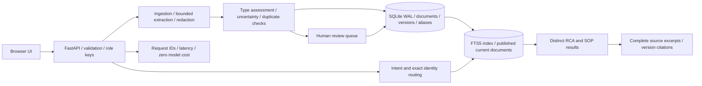

# Incident Atlas

[](https://github.com/ashwanii/incident-atlas/actions/workflows/quality.yaml)  

A FastAPI application for RCA and SOP knowledge: ingestion, versioning, separate search results, live-issue suggestions, source-grounded chat, legacy review, and a browser UI. No TOML configuration or files are used by this project. Dependencies are in `requirements.txt`; deployment uses YAML and environment variables.

**Scope:** a working, production-minded single-node reference implementation. It is deliberately extractive and lexical, not an LLM chatbot. It preserves procedures and makes uncertainty visible. Semantic recall, enterprise identity, high availability, and real-corpus performance remain deployment work. Read [DESIGN.md](DESIGN.md) and [REPORT.md](REPORT.md) before assessing suitability.

## Start with one command

Prerequisites: Docker Engine with Compose, Python 3 (only for generating local access keys).

```sh
sh scripts/bootstrap.sh
```

Run this from the repository root. The script creates `.env` with independent random reader and curator keys, then builds and starts the application. Open **http://localhost:8000** and copy the appropriate key from `.env` into the UI. The key stays in page memory. The reader can search/chat; only the curator can ingest, delete, review or view metrics. Do not commit `.env`.

With keys already configured, the direct system command is `docker compose up --build -d`. The database and index persist in the `atlas-data` volume. No external model, vector service, frontend build, or cloud API is needed.

See [HOW_TO_RUN.md](HOW_TO_RUN.md) for local Python setup, sample data, curl examples, tests, troubleshooting and shutdown.

## Architecture



## Main features and decisions

- Stable source keys map to stable IDs; line-ending-normalized content hashes coalesce exact duplicates, including concurrent uploads. Source aliases preserve identity when a renamed duplicate is edited.
- The same transaction updates the current document, version snapshot, audit entry and full-text index. Edits do not leave old indexed chunks; deletion removes the index and conversation pointers.
- Legacy content is classified using transparent structural rules. Mixed, incomplete, conflicting and near-duplicate documents enter a curator-only queue. Confidence is a heuristic score, not a calibrated probability.
- ID lookup and quoted title lookup never fall through to fuzzy retrieval. Equal titles expose ambiguity. Results and suggestions keep RCA/SOP separate.
- Questions route by intent and topic. Chat returns the full redacted source, with its version; procedures are not summarized or reordered. Missing evidence causes abstention.
- Files are streamed with a byte limit, parsed by content/type rules, and never saved under client filenames. PDFs use an isolated subprocess with a timeout and Linux memory/CPU limits. Secrets are redacted before persistence/indexing.
- API errors have safe messages. Storage outages return 503. Metrics failures do not fail successful reads. No raw document bodies or questions are written to application request logs.
- Local FTS5 avoids vector infrastructure and model charges. Model calls, tokens and model dollars are exactly zero in this implementation; hosting still costs money.

## Repository

```text
app/
  main.py                 FastAPI entry point, auth, middleware, HTTP endpoints
  api/schemas.py          validated request contracts
  core/                   configuration, transactional DB access, application errors
  services/               ingestion, file parsing, retrieval, intent and chat
  static/                 UI HTML, CSS and JavaScript (no build step)
tests/                    ingestion, concurrency, safety and isolation regressions
evaluation/               declared cases, evaluator and actual raw results
examples/                 greenfield and legacy sample corpus
scripts/                  bootstrap, seed and backup utilities
docs/                     isolation and verification evidence
.github/workflows/        pre-merge quality gate
Dockerfile / compose.yaml
requirements.txt / requirements-lock.txt
DESIGN.md / REPORT.md / HOW_TO_RUN.md / CUTS.md
```

## Verification

```sh
python -m pytest -q
python -m evaluation.run
python -m evaluation.benchmark
```

The CI workflow runs these checks and uploads raw evaluation results. These gates catch defined regressions; the tiny synthetic evaluation does not establish operational accuracy. See `docs/VERIFICATION.md` for the actual environment and results, and `docs/ISOLATION.md` for explicit isolation evidence.

## API surface

| Route | Purpose | Role |
|---|---|---|
| `POST /api/documents` | Structured or pasted legacy ingestion | Curator |
| `POST /api/uploads` | TXT/MD/PDF extraction and legacy ingestion | Curator |
| `GET /api/documents` | Published current documents, up to 100 | Reader |
| `GET /api/documents/{id}` | Published complete source | Reader |
| `DELETE /api/documents/{id}` | Soft delete and index removal | Curator |
| `GET /api/review` | Quarantined sources, up to 100 | Curator |
| `POST /api/documents/{id}/review` | Approve or quarantine | Curator |
| `GET /api/search?q=...&kind=RCA` | Exact or lexical search | Reader |
| `GET /api/suggest?q=...` | Distinct RCA/SOP suggestions | Reader |
| `POST /api/chat` | Contextual source-excerpt conversation | Reader |
| `GET /api/metrics` | Recent request latency/error aggregates | Curator |
| `GET /health/live`, `/health/ready` | Process and storage health | Public |

Interactive API documentation is available at `/docs`. It contains schemas; protected calls require the `X-API-Key` header.

## Known limits

Single-node SQLite is not a multi-region architecture. There is one shared reader scope, not tenant/service ACLs or SSO. Legacy mixed documents require curator splitting; the system does not invent a safe automatic boundary. No OCR, DOCX import, automatic source synchronization, calibrated classifier, embedding search, generated synthesis, or streaming responses. Near-duplicate detection is a bounded-content O(N) ingestion pass, not scalable global similarity search. Freshness warnings do not certify procedure safety. Secret patterns are a partial defense, not complete DLP. Before deployment, add organization identity and ACLs, TLS, ingress limits, backup/restore validation, a real labeled corpus and load testing. See the design and cuts for the complete production plan.

## License

[MIT](LICENSE)
